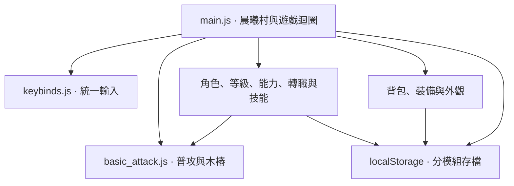

# 神寵開發與驗收

上傳原始碼以含五轉試煉的 Alpha 1.0.3 為識別。package.json 仍顯示 0.0.0。匯入基準與後續修正分開提交，方便比較、回溯和驗收。上游 main 起點為 7d6ee0a。

## 基準盤點

| 系統 | 已接到遊戲入口 | 待完成 |
| --- | --- | --- |
| 晨曦村 | 平台、跳躍、鏡頭、NPC、小地圖 | 森林與城鎮入口目前只顯示提示 |
| 御靈師 | 創角、待機／跑跳／落地、八格普攻、木樁、傷害和重生 | 主動技能共用部分特效，缺受傷／死亡狀態與通用動畫控制 |
| 成長 | Lv.200、EXP、配點、五轉試煉、六主動七被動技能 | EXP 目前由木樁和測試入口供應，底部 HP 為固定顯示 |
| 戰鬥 | 普攻及技能可命中木樁，技能扣 MP、回魔、冷卻 | 怪物 AI、玩家受傷、掉落、多段命中及真正副本進程 |
| 神寵 | 領蛋、孵化、跟隨、餵食和覺醒 | 戰鬥協作與實際融合 |
| 裝備／存檔 | 背包、穿卸、御靈師固定外觀及瀏覽器本機存檔 | 裝備加成尚未接入統一能力模型。舊外觀模組仍在執行，其他職業仍有穿戴圖形 |
| 架構 | Phaser 單場景與 DOM 視窗 | 多人伺服器、帳號、同步 |

## 架構

## 重構順序

1. 共用木樁扣血與重生，固定技能快捷欄 DOM，讓 MP HUD 讀取技能系統目前值。本次完成。
2. 把木樁做成獨立的可受擊目標。以擊殺事件串起 EXP 與試煉，保留原本擊殺和重生節奏。加入晨露史萊姆，驗收移動、追擊、玩家受傷、死亡、重生及獎勵。
3. 統一角色資料寫入和角色識別。在遷移舊 key 前寫測試，涵蓋 AP／SP／轉職／裝備配點及重新載入。HUD、施法和回復共用生命魔力值。
4. 從 main.js 抽出人物動作與貼圖選擇，統一待機、跑跳、普攻、技能、受傷和死亡的優先序。保留現有御靈師素材及碰撞框。清除重複外觀路徑前先驗證現有畫面。
5. 技能表接上共用命中、不同特效和多段傷害。最後擴充怪物表和神寵協作。

## 日常開發

使用 Node.js 24。Windows 在乾淨工作區先確認 `git status -sb`、`git remote -v` 與 `git fetch origin`。基準合併後，從同步的 main 開一個功能分支。完成一個可單獨驗收的改動後，執行 `npm ci`、`npm test`、`npm run build`，再用 `npm run dev` 或 `npm run preview` 驗收。

CI 為 Ubuntu 與 Windows 執行安裝、測試和建置。推到 GitHub 功能分支並開 PR 後，確認兩個檢查通過及 Windows 遊戲驗收，再合併。瀏覽器存檔與網站來源綁定，測試前可用獨立瀏覽器設定檔，原存檔驗收時沿用原本的網址與埠。

驗收時建立御靈師，走跳、向右對木樁按 J，按 S 學靈能衝擊，再用 1 或點擊快捷欄施放。檢查冷卻、MP、重生和 EXP，重新載入後檢查技能存留。用 T 開試煉、反引號開按鍵設定，最後穿卸裝備確認御靈師圖像一致。
